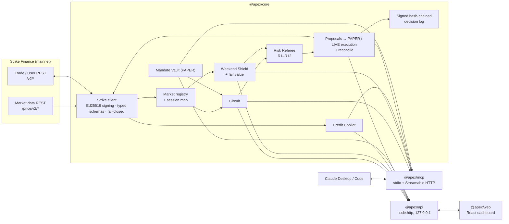

# Apex — the AI risk desk for Strike

**Apex is an AI risk copilot and MCP service for [Strike Finance](https://strikefinance.org).** Traders analyze Strike's markets (crypto, stocks, indices, commodities) from Claude, simulate a trade's risk before it exists (**Circuit**), protect positions against weekend and closed-session gaps (**Weekend Shield**), monitor Borrow-and-Earn credit lines (**Credit Line Copilot**), and watch a rule-governed paper vault (**Mandate Vault**). A trade-only API wallet plus a deterministic **Risk Referee** enforce the user's limits. Every decision is written to a hash-chained, signed log.

> Built for the Strike Hackathon (Oct 21–23, 2026). Everything below is labeled truthfully: **Working**, **Paper** or **Roadmap**. Every number Apex shows carries a label: `LIVE` (straight from Strike), `ESTIMATE` (computed by Apex), `SCENARIO` (stress) or `PAPER` (simulated account).

## The problem

- **Weekend gaps.** Strike lists perps on NVDA, TSLA, NAS100, gold and more. They trade 24/7, but their underlying markets close. The risk is concentrated in those closed windows, and no exchange UI tells you how likely a closed-session move is to reach your liquidation price.
- **Hidden pre-trade risk.** Liquidation price, tier-dependent maintenance margin, order-book slippage, funding and concentration are only visible after you trade.
- **Credit lines are complex.** Borrow-and-Earn health mixes collateral price, vault value and two boundaries (joint risk and the collateral floor).
- **Unsafe AI automation.** An LLM with a trading key needs hard rails: limits it can't talk its way around, confirmation before anything real, and an audit trail.

## Features

| Feature | Status | What it does |
|---|---|---|
| **Circuit** (pre-trade simulator) | **Working** | Liquidation price from Strike's own margin-tier formulas, fees from `/v2/fee-tiers`, slippage by walking `/v2/depth`, hourly funding cost, portfolio impact, stress at 2/5/8 % + custom, risk/reward, weekend exposure, and the referee's verdict. When a trade is blocked, it offers the largest compliant alternative with its own Circuit report. |
| **Risk Referee** | **Working** | 12 deterministic rules (leverage incl. a closed-session cap, position/portfolio notional, concentration, liquidation distance, class/symbol, market status, data freshness, action rate, exchange filters, protective-order validity, mode). Fails closed. |
| **Weekend Shield** | **Working** | Underlying session map (NYSE calendar incl. 2026–27 holidays, CME Globex, "unknown" for unclear listings). Builds the empirical distribution of close → open moves from Strike's own 1h mark history (or a modeled σ·√h when history is short) and computes `p_gap`, the probability that a closed-session move reaches your liquidation distance. LOW/MEDIUM/HIGH bands, flags (`STALE_MARK`, `THIN_BOOK`, `UNDERLYING_UNKNOWN`), and protection proposals: reduce-only stop, partial close, isolated-margin add. |
| **Protected execution** | **Paper**; LIVE implemented, not yet run on mainnet | propose → referee → human confirm → execute → reconcile. PAPER simulates fills on the live order book. The LIVE path (reduce-only stop, reduce-only partial close, isoMargin add, cancel) is implemented against the spec and tested against a mocked Strike. It sends exactly one signed request and reports Strike's own reconciled status, but it has **not been run on mainnet** (see *Verification*). LIVE opens are refused by design. |
| **MCP server** (stdio) | **Working** | 21 tools for Claude Desktop / Claude Code (list below). Verified by spawning the built server over stdio with the MCP SDK client against mainnet. |
| **MCP Streamable HTTP** | **Working (local)** | `127.0.0.1:8788/mcp`, stateless, DNS-rebinding protection. Prepares remote/ChatGPT hosting. |
| **Dashboard** | **Working** | An **Overview** page that proves the system live: Apex's liquidation prices vs Strike's for real positions, a live Circuit verdict with its compliant alternative, weekend gap risk for every TradFi market with sparklines, and log integrity. Also Markets radar (auto-refresh), Circuit, Positions & Weekend Shield (Protect → Confirm), Credit, Vault and Decision log (chain verification). Mode badge always visible; works at 1440 px and 390 px. |
| **Credit Line Copilot** | **Working** (user-entered line values) | Exact Borrow-and-Earn formulas: c, v, Φ(v), joint risk J, credit health score, Active/Recovery, recovery-boundary collateral price, the minimum repay or extra collateral to reach the completion targets J\* and F\*, and a stress heatmap. Strike has no per-user credit-line endpoint, so you enter q, D and s; prices are live. |
| **Fair-value bands** | **Working** (ESTIMATE) | For stock/index perps while the cash market is closed: β on the NAS100/SP500 perp from weekday 1h returns, implied price, ±2σ band, R² and sample counts. Shows "no reliable band" when R² < 0.2. |
| **Mandate Vault** | **Paper** | A published mandate (`config/mandate.json`): weekend reversion toward fair value, always flat before the open, drawdown kill-switch. Every candidate goes through Circuit + referee; paper fills; template reasoning in the signed log. |
| **Decision log** | **Working** | Append-only JSONL, `hash = sha256(prevHash + canonicalJSON(entry))`, Ed25519-signed with a key separate from the trading key. `verify_log` recomputes the chain and every signature. |
| Builder codes, Telegram alerts, on-chain log anchoring, hosted deployment | **Roadmap** | See below. |

## How Apex uses Strike

Every endpoint Apex actually calls. Market data lives under `/price` on the main host. No auth headers are ever sent on public calls.

| Endpoint | Auth | Used for |
|---|---|---|
| `GET /price/v2/exchangeInfo` | public | Symbols, `PRICE_FILTER` / `LOT_SIZE` / `MARKET_LOT_SIZE` / `MIN_NOTIONAL` filters (R10, sizing, tick rounding) |
| `GET /price/v2/marketStats` | public | Category/subCategory, perp status (R7), mark/index/last, hourly funding, OI, 24h volume |
| `GET /price/v2/depth` | public | Slippage depth walk, PAPER fills, `THIN_BOOK`, spread |
| `GET /price/v2/klines` (1h, `priceType=mark`, paginated) | public | Closed-window gap distribution, σ, `STALE_MARK`, fair-value regression |
| `GET /price/v2/markPrice` | public | Phase 0 verification |
| `GET /v2/markets` | public | Margin tiers, `quote_prec`, mark, funding: liquidation math (validated against Strike) |
| `GET /v2/fee-tiers` | public | Taker/maker rates for Circuit and PAPER fills |
| `GET /v2/time` | public | Clock sync for request signing |
| `GET /v2/credit/settings` | public | Per-asset M, X, d; approved vaults |
| `GET /v2/credit/collateral-assets` | public | Live collateral price and freshness |
| `GET /v2/vaults?type=protocol`, `GET /v2/vault/:id` | public | SLP vault id and share price (credit V = s·S) |
| `GET /v2/account`, `/v2/balances`, `/v2/positions`, `/v2/history/order` | API wallet, or public `vault_id` | Account, wallet, positions (incl. Strike's `liquidation_price`), order history |
| `POST /v2/order` (`type: stop` / `market`, `reduce_only: true`) | API wallet | LIVE protective stop / partial close |
| `GET /v2/order?symbol=&client_order_id=` | API wallet | LIVE reconciliation (20 s) |
| `DELETE /v2/order/cancel` (signed JSON body) | API wallet | LIVE cancel |
| `POST /v2/isoMargin` (`modify_type: add`) | API wallet | LIVE isolated-margin top-up |

**Signing:** Ed25519 over `METHOD:PATH?QUERY:TIMESTAMP:NONCE:sha256(body)`, with timestamps 1 s behind server time, UUID nonces and the body serialized once. This is tested against RFC 8032 vector 1 and round-trip verified.

**Validation against Strike:** Apex's liquidation formula reproduces Strike's `liquidation_price` for **33/33** live SLP-vault positions (cross profile, 33 markets), within 0.002 %. The tolerance is 1 %.

## Architecture



## Safety model

- **Trade-only key.** A Strike API wallet can view, place and cancel orders and change leverage. It **cannot withdraw or deposit**. Apex never touches deposits, withdrawals, vault deposits/withdrawals, or credit draws/repayments.
- **PAPER by default.** LIVE needs all of: `APEX_MODE=live`, API keys, a referee APPROVE at execution time (fresh data re-fetched), and an explicit per-action human confirmation (`execute_proposal` with `confirm: true`; the dashboard asks again). Proposals expire after 120 s and are hash-locked.
- **Risk Referee rules:** R1 leverage (closed-session cap when the underlying is closed/unknown) · R2 position notional · R3 portfolio notional · R4 concentration · R5 liquidation distance · R6 class/symbol · R7 market ACTIVE · R8 data freshness (mark 15 s, depth 10 s, account 15 s) · R9 action rate · R10 exchange filters · R11 protective orders reduce-only and not triggering immediately · R12 mode. Reductions bypass R1–R6 and R9 but never R7, R8, R10, R11 or R12.
- **Fail closed.** Missing or stale data, unknown symbols, unexpected response shapes and any non-2xx response block the action. Nothing is retried blindly, and writes are never retried.
- **Money math** uses `decimal.js` everywhere. Sizes are floored to the step, prices rounded to the tick away from triggering.
- **Decision log** is signed with its own Ed25519 key and verifiable at any time.
- **Plain limit:** *Apex's limits are enforced by Strike key permissions and the Apex referee, not by an on-chain contract. Estimates are not guarantees and not financial advice.*

## Setup

Requirements: Node 20+ (tested on 26.4), pnpm 10.

```bash
pnpm install
```

```bash
cp .env.example .env
```

Optional: register an API wallet at <https://app.strikefinance.org/api-keys> and put `STRIKE_API_PUBLIC_KEY` / `STRIKE_API_PRIVATE_KEY` into `.env`. Without keys, Apex runs on public data with the PAPER account, and can show the SLP vault's real positions read-only.

```bash
pnpm build
```

```bash
pnpm test
```

### Connect Claude Desktop (stdio MCP)

Add this to `claude_desktop_config.json` (Windows: `%APPDATA%\Claude\claude_desktop_config.json`), adjusting the path. The server reads `.env` from the repo root itself.

```json
{
  "mcpServers": {
    "apex": {
      "command": "node",
      "args": ["C:\\STRIKE\\apex\\packages\\mcp\\dist\\index.js"]
    }
  }
}
```

Claude Code: `claude mcp add apex -- node /abs/path/apex/packages/mcp/dist/index.js`

Streamable HTTP (local): `pnpm mcp:http` → `http://127.0.0.1:8788/mcp`.

**Tools:** `list_markets`, `get_market`, `get_account_summary`, `get_positions`, `get_order_history`, `simulate_trade`, `stress_test_position`, `weekend_risk_report`, `get_fair_value`, `credit_line_health`, `credit_stress_grid`, `propose_protection`, `propose_trade`, `execute_proposal`, `cancel_order`, `get_policy`, `set_policy`, `get_decision_log`, `verify_log`, `vault_status`, `vault_decisions`.

### Dashboard

```bash
pnpm dashboard
```

Open <http://127.0.0.1:8787>. Seed the paper account for the demo:

```bash
pnpm demo:seed
```

### Read-only live checks

```bash
pnpm smoke
```

`pnpm circuit` (live NVDA report + liquidation validation), `pnpm weekend` (all TradFi markets), `pnpm vault:tick` (one PAPER mandate evaluation), `pnpm mcp:smoke` (spawns the stdio server and calls three tools).

## Demo script

Every scene shows on screen whether it is LIVE, PAPER or SCENARIO. Full script: [docs/DEMO.md](docs/DEMO.md).

1. **Claude: "What's my weekend risk across Strike?"** → `weekend_risk_report`. It covers every stock, index and commodity perp: session state, hours to open, EMPIRICAL/MODELED method with sample counts, `p_gap` per position. (Positions: PAPER account, or the SLP vault read-only.)
2. **Claude: "Simulate a $1,000 NVDA long at 10x."** → `simulate_trade`. Circuit blocks it (R1, R2, R4, R5) and offers a compliant alternative (e.g. 2.34 NVDA at 3x while the US market is closed) with its own numbers.
3. **Claude: "Protect my position."** → `propose_protection` → user confirms → `execute_proposal` (PAPER) → the entry appears in the dashboard's Decision log, and **Verify** shows the chain intact.
4. **Dashboard → Credit:** live ADA and SLP prices, health score, recovery-boundary ADA price, fix amount, heatmap.
5. **Dashboard → Vault:** the published mandate, its logged decisions ("no trade: mark inside the band…"), paper equity and drawdown.

Demo video: _link added at submission_.

## Business model

- **Builder-code fees** (roadmap via Strike builder connect): Apex-originated protective orders carry Apex's builder code with a small, user-approved fee (`X-Builder-Fee-Bps`).
- **Vault leader fees:** run Mandate Vaults as real Strike user vaults (10 % default leader fee) once the paper track record justifies it.
- **Premium monitoring:** always-on Weekend Shield and credit-line alerts for active traders and vault depositors.

## Roadmap

- Builder connect onboarding plus builder-code fees on protective orders.
- Alerts (Telegram/email) when `p_gap` or credit health crosses a band.
- On-chain anchoring of decision-log heads (Cardano metadata).
- Hosted Streamable HTTP MCP with auth (ChatGPT / remote Claude).
- User-stream (WebSocket) reconciliation, per-account fee tier, CME holiday calendar, cited sessions for non-US listings.
- Live Mandate Vault as a Strike user vault (separate explicit approval).

## Verification summary

Details: [VERIFICATION.md](VERIFICATION.md). Status per phase with evidence: [docs/IMPLEMENTATION_STATUS.md](docs/IMPLEMENTATION_STATUS.md).

**Verified live (mainnet):**
- All public endpoints above, with responses saved in `fixtures/live/`.
- Account, positions, open orders and order history shapes, via the public `vault_id` selector.
- Liquidation formula: 33/33 positions match.
- `fundingRate` is hourly.
- 9 stock/index perps are labeled "Crypto" by `marketStats`; Apex corrects them from a cited session map and shows `CATEGORY_MISMATCH`.
- NYSE 2026–27 calendar.
- Stdio and HTTP MCP against mainnet.

**Assumed / not yet verified:**
- Signed own-account requests (no API keys during the build). The LIVE write path has not been sent to Strike. It follows the spec and is mock-tested, and the README will be updated if a LIVE run happens.
- CME holidays are not modeled. Nasdaq is assumed to share NYSE holidays.
- Sessions for SKHYNIX, CXMT, UNITREE, MINIMAX, ZHIPU, SPCX and DRAM are unknown and scored conservatively.
- Fees use base tier 0.
- Credit line values are user-entered.

## Repository layout

```
config/            policy.default.json, mandate.json, sessions.ts, credit.ts, thresholds.ts
fixtures/live/     real Strike responses captured during the build
packages/core      Strike client, registry, referee, Circuit, Shield, credit, fair value, vault, log, service
packages/mcp       MCP server (stdio + Streamable HTTP)
packages/api       local dashboard API (node:http)
packages/web       Vite + React dashboard
scripts/           phase0-verify, smoke-live, circuit-live, weekend-live, demo-seed, vault-tick, MCP smokes
docs/              IMPLEMENTATION_STATUS.md, BLOCKERS.md, DEMO.md, evidence/
```

License: MIT.
